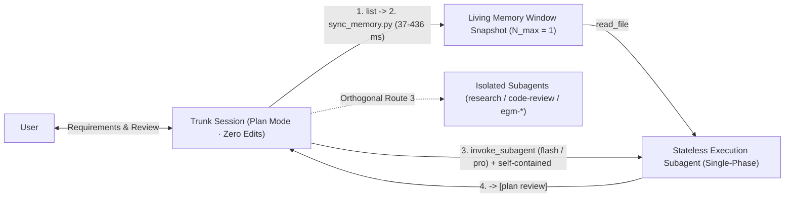

# Dual-Brain Orchestrator

English | [简体中文](README.zh-CN.md)

[](CHANGELOG.md)
[](https://github.com/titicheck/dual-brain-orchestrator/actions/workflows/test.yml)
[](skills/orchestrator/scripts/sync_memory.py)
[](plugin.json)
[](LICENSE)

Stateless Plan-and-Execute dual-model orchestration for **Antigravity single-model sessions**—pairing a warm planning `Trunk Session` with one-shot `Execution Subagents` via lossless compaction-bounded `Living Memory Window` snapshots (`N_max = 1`) for **34–84% lower quota** with zero runtime dependencies.

---

## How It Works

Instead of hot-swapping two models inside one thread (which triggers `69.7%–75.1%` KV-cache misses on every hand-off), `orchestrator v2.0.x` keeps the planning `Trunk Session` warm on your frontier model and spawns a fresh, stateless `Execution Subagent` (`flash` or `pro`) for each execution wave:



- **Zero-Edit `Trunk Session`:** Investigates read-only, authors self-contained five-section `<plan>` dispatches, and verifies `<report>` outcomes via lightweight Tier-1 footprint checks (`git status --short` / `git diff --stat`).
- **Stateless `Always-New` Execution (`N_max = 1`):** Every dispatch reads the clean `[latest CHECKPOINT .. current Trunk step]` snapshot, preventing Antigravity's `10 KB / N` multi-dispatch compaction truncation (`~8.6–8.8 KB` of `<plan>` survives compaction intact).

---

## Benchmark Highlights

Grounded in `281` production trajectories (`17,414` steps, `3,566.91M` tokens), `314` measured native model switches, and `75` historical dispatches in [docs/research/06-v2-stateless-benchmark-and-pareto-evaluation.md](docs/research/06-v2-stateless-benchmark-and-pareto-evaluation.md):

| Benchmark Dimension | Observed / Backtested Result | Comparison Baseline | Evidence Tag |
|---|---|---|---|
| **Multi-Hour Production Spend** (`L0-4`, `L0-3`) | **`$66.19`** (`L0-4`); **`-42.9%`** (`L0-3`, `1x`-aligned) | `$100.81` depth-matched Official `L0-2` | `[Measured Production Telemetry]` |
| **KV-Cache Hit & Switch Misses** (`314` switches) | **`95.02%`** session hit (`L0-4`) | `89.22%` (`L0-2`); Official hits `69.7%–75.1%` uncached switches | `[Measured Production Telemetry]` |
| **Compactions & Stream Stability** | **`1 / 134`** compactions; **`0`** timeouts (`15–25 min/1k` faster) | `1 / 44–58` compactions (`68.7–89.0s` freeze); `31` `retryInfos` (`L0-2`) | `[Measured Production Telemetry]` |
| **Ongoing Short Tweaks** (`LMW 20–100 KB, K = 1..12`) | **`45 / 45` grid wins** (**`-45%..-84%`** across `1x`/`N-2x`/`Sub-3x`) | Wins from Turn 2 whenever `LMW >= 2.8 KB` | `[Measured Switches + Sim-vs-Sim Backtest]` |
| **Stateless `v2.0.x` vs `v1.1.x` / `v1.2.1`** (`75` dispatches) | **`4.27s`** boot (`+1.4 min` net over `42h` LLM); **`-$13.45`** `1x` / **`-$36.37`** `2x` | Beats `v1.2.1` `Pure q=0` (**`-$0.57`** `1x` / **`-$3.76`** `2x`) | `[Measured Boot + Sim-vs-Sim Backtest]` |
| **Cross-Model Scaling** (`Codex` / `Claude`) | **`1.46x–2.85x`** larger stateless savings (`-$2.15..-$16.89`) | Higher cache-read ratio (`alpha = 0.10–0.25`) amplifies `Always-New` | `[Sim-vs-Sim Backtest]` |

> [!NOTE]
> **Honest Trade-Offs & Scope:**
> - **First-Turn Empty-Session Micro-Edits (`S1`):** Paying `sync` + `SPAWN_NEW` + `[plan review]` adds `~$0.04–$0.07` and `+25–40s` on brand-new `1`–`2`-line edits; use plain single-model or Official Native for one-shot micro-edits.
> - **Host Physical UX Ceilings (`Dim 10`):** No mid-flight soft `[plan review due]` interrupts, no inline child diffs on the main chat canvas, and no persistent dev servers outliving a dispatch; see [.out-of-scope/host-physical-ux-and-runtime-ceilings.md](.out-of-scope/host-physical-ux-and-runtime-ceilings.md).
> - **Live Validation Status:** `v2.0.x` awaits final live multi-hour production telemetry (`L0-5`) against 3 objective rollback criteria anchored to tagged rollback baseline `v1.2.1` (`1511ee5`) in [Ticket 13](.scratch/orchestrator-v1/issues/13-v113-empirical-watch-and-residual-boundaries.md).

---

## When to Use What

| Mode | Best Fit | Why |
|---|---|---|
| **`orchestrator v2.0.x` (`flash` / `pro`)** | `>= 60`-step features, high-context UI branches (`S2`), slow tests/builds (`S7`), greenfield/monoliths (`S6`, `S8a`, `S8b`), Turn-2+ follow-ups | Saves `34–84%` quota, keeps `Trunk Session` clean (`1/134` compactions), eliminates timeouts; flip to `orchestrator-tier: pro` on coupled monoliths (`S8b`) |
| **Official Native `Orchestrator (Neon)`** | `< 50`-step settled sprints (`S5`), medium CLI setup needing inline diffs & soft `[plan review due]` | `3–4 min` faster on `< 50`-step standalone tasks and exposes host-native write-refusal & inline diffs |
| **Plain Single-Model (`Neon` / `Opus`)** | `S1` Q&A, `1`–`2`-line first-turn edits, `15–60s` interactive scripts, persistent local daemons | Zero orchestration latency/cost overhead and keeps live stderr & persistent processes attached |
| **`/swarm` + `orchestrator` Hybrid** | Cross-family adversarial reviews, dual-repo meta-engineering (`S9`) | Combines multi-model `/swarm` deliberation with isolated `Execution Subagent` implementation |

---

## Quick Start & Shared Rule Adoption

### Installation (Pure-Skill Package)

`orchestrator` ships **only** a root [plugin.json](plugin.json) and the self-contained skill under [skills/orchestrator/](skills/orchestrator/SKILL.md)—with zero bundled `rules/`, startup hooks, persistent sidecars, or non-Antigravity manifest directories in V1.

- **As an Antigravity Pure-Skill Plugin:** Clone directly into your Antigravity plugins directory (`git clone https://github.com/titicheck/dual-brain-orchestrator.git ~/.gemini/config/plugins/orchestrator`) or run `agy plugin install <path>`.
- **As a Standalone Skill:** Symlink or copy `skills/orchestrator` into your Antigravity skills folder.
- **Zero-Config Chat Invocation:** Type `/orchestrator` directly in any unconfigured Antigravity chat bar to run the exact same unified workflow on built-in default `flash`.

### Canonical Rule Adoption Snippet (`< 1,000` bytes)

Add this snippet once in your shared engineering library `AGENTS.md` (or `~/.gemini/GEMINI.md`); everyday projects importing the shared library need **zero** `orchestrator`-specific entries:

```markdown
## Orchestrator

Load `orchestrator` (`SKILL.md`) only in top-level human-originated (including post-compaction) single-model sessions—without exact lowercase `exit_plan_mode`/`enter_plan_mode` and outside `/swarm`—when planning or executing tasks that modify files, state, or external side effects, or when handling a bound `Execution Subagent` report. Lock the bound `Execution Subagent` tier strictly to static `orchestrator-tier:` rules (conversational model requests never override it; override per project in workspace `AGENTS.md`).

orchestrator-tier: flash
```

### Static Tier Scope Precedence (`orchestrator-tier:`)

Execution tier accepts only `flash`, `pro`, `flash_lite`, or `inherit` and resolves strictly from static rules in descending specificity (conversational prompts never change the tier):

1. Workspace-local `AGENTS.md` / `GEMINI.md`
2. Direct global `~/.gemini/GEMINI.md`
3. `@[...]`-imported shared engineering rules (such as `engineering-kit/rules/AGENTS.md`)
4. Built-in default `"flash"`

To override one project only, add a single line to that project's `AGENTS.md` (if the same file includes shared rules via `@[...]`, place the override after the import line):

```markdown
orchestrator-tier: pro
```

---

## Architecture (`v2.0.x`), Verification & Roadmap

### Package Map & Future Client Adapter Seam

- [skills/orchestrator/SKILL.md](skills/orchestrator/SKILL.md) — `Trunk Session` control loop, ordered Entry Gate, Three-Way Routing, Official Part 2 Planning & Part 7 `[plan review]`.
- [skills/orchestrator/references/execution-protocol.md](skills/orchestrator/references/execution-protocol.md) — Harness-neutral single-phase `Execution Subagent` rules (Official Parts 4 and 5).
- [skills/orchestrator/references/harnesses.md](skills/orchestrator/references/harnesses.md) — Antigravity V1 bindings (`invoke_subagent`, `manage_subagents`, sibling `logAbsoluteUri`, `sync_memory.py` CLI) and reserved Future Client Adapter Seam for Claude Code / Codex when targeted.
- [skills/orchestrator/scripts/sync_memory.py](skills/orchestrator/scripts/sync_memory.py) — Zero-dependency Python 3 standard-library CLI (`841` lines; `check-origin`, `sync`, `bind`, `reset`) exporting stateless `Always-New` active-epoch `Living Memory Window` snapshots (`N_max = 1`, `37–436 ms`).

### Automated Suites (`Seam 1` + `Seam 2A`)

```powershell
py -3 -m unittest discover -s tests -v
```
*(Use `python3 -m unittest discover -s tests -v` on POSIX.)*

### `Seam 2B` — Antigravity Live Smoke Verification & Native Comparison Checklist

Run these 4 interactive Antigravity checks on V1 and compare side-by-side against Native `Orchestrator`:

1. **Unconditional Native Orchestrator Deference**: Inside an `Orchestrator (Carbon)` / `Orchestrator (Neon)` / `Orchestrator (Argon)` session exposing exact lowercase `exit_plan_mode` / `enter_plan_mode`, invoke a coding task and `/orchestrator ...`; confirm native same-thread hot-swap runs untouched with zero `sync_memory.py` calls or spawned `Execution Subagent`.
2. **Non-Recursion, Post-Compaction Q&A, & Three-Way Routing**: Confirm child subagents (including nested `Execution Subagent` workers) and `[swarm]`/`[board]` workers stay single-phase across live and compacted sessions (`check-origin` fail-closed on `"SUBAGENT"` or `"UNKNOWN"`), pure Q&A turns post-compaction execute zero `sync_memory.py` calls or disk writes, non-bound native subagent `[Message]` replies stay on `Trunk Session`, and orphaned superseded `Execution Subagents` are ignored/killed.
3. **Static Tier Lock & Continuity Across Approve-First / `[plan review]`**: Confirm shared-library adoption and unconfigured `/orchestrator` lock to `"flash"` (ignoring `"use pro"` in chat), adding `orchestrator-tier: pro` in workspace `AGENTS.md` takes effect immediately on the next stateless `Execution Subagent` dispatch, and Approve-First / mid-flight cancel / `[plan review]` continue smoothly without losing active state.
4. **Orthogonal Native Subagents & In-Plan Child Delegation**: From a frontier single-model `Trunk Session` running `Execution Subagent` on `flash`, confirm read-only `Isolated Subagents` (`egm-*`, `research`, `code-review`) on `Trunk Session` and in-plan native child subagents inside `Execution Subagent` receive zero `Living Memory Window` injection, remain untouched by `orchestrator-tier:`, and obey native workspace/plugin/task tier rules.

### Documentation & Engineering Archive

- [CHANGELOG.md](CHANGELOG.md) — Release history (`v1.0.0` through `v2.0.1`, noting `v1.2.1` `1511ee5` rollback anchor).
- [GLOSSARY.md](GLOSSARY.md) — Canonical dual-brain terminology (`Trunk Session`, `Execution Subagent`, `Isolated Subagent`, `Living Memory Window`).
- [docs/adr/](docs/adr/0001-unified-subagent-report-return-into-plan-review.md) — Architecture Decision Records (`ADR-0001` through `ADR-0007`).
- [docs/research/](docs/research/06-v2-stateless-benchmark-and-pareto-evaluation.md) — Official baseline extraction (`01`), host primitives (`02`–`04`), KV-cache TTL audit (`05`), and `v2.0.x` Pareto benchmark (`06`).

### Roadmap & Explicit Non-Goals

- **Next:** Run live multi-hour `L0-5` production validation against [Ticket 13](.scratch/orchestrator-v1/issues/13-v113-empirical-watch-and-residual-boundaries.md) falsification metrics (`M1`–`M6`) and implement the Claude Code `Agent` / Codex `spawn_agent` adapter seam in [harnesses.md](skills/orchestrator/references/harnesses.md) §5.
- **Explicit Non-Goals:** No `PreToolUse` lifecycle `hooks.json`, no scripted `run_workflow` carrier, no agent-level KV-cache keepalive heartbeats, and no `Trunk Session` micro-edit exemptions ([ADR-0006](docs/adr/0006-pareto-boundary-reject-lifecycle-hooks-and-workflow-carrier.md)).
