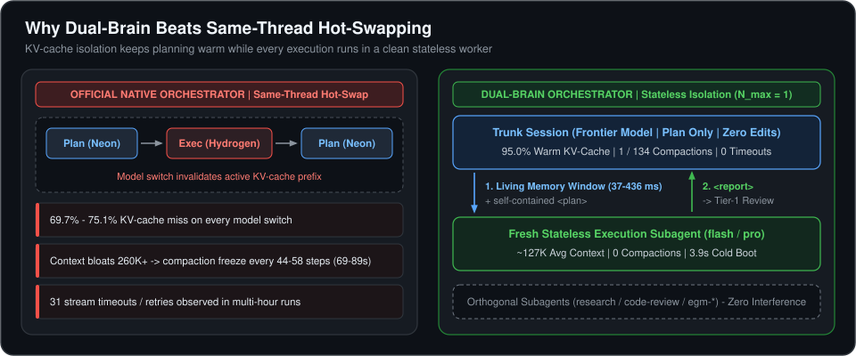
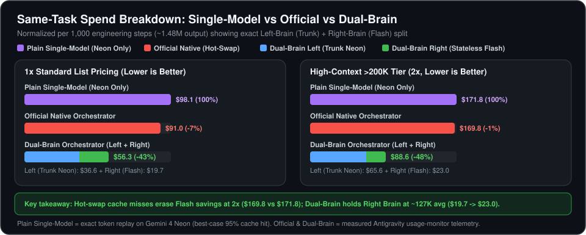
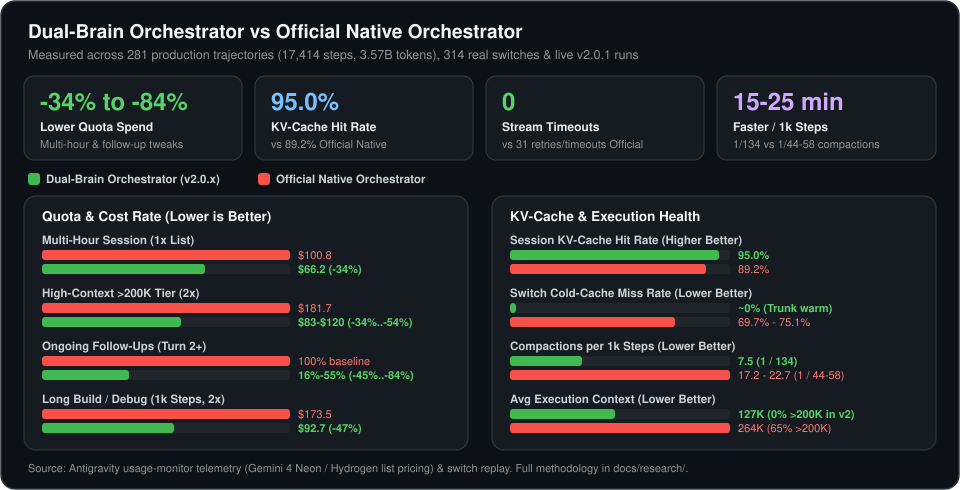

# Dual-Brain Orchestrator

English | [简体中文](README.zh-CN.md)

[](CHANGELOG.md)
[](https://github.com/titicheck/dual-brain-orchestrator/actions/workflows/test.yml)
[](skills/orchestrator/scripts/sync_memory.py)
[](plugin.json)
[](LICENSE)

Stateless Plan-and-Execute dual-model orchestration for **Antigravity single-model sessions** -- keeping a frontier `Trunk Session` warm in KV-cache while dispatching each execution wave to a fresh stateless `Execution Subagent` for **34%-84% lower quota** with zero runtime dependencies.

---

## How It Works



- **Warm, Zero-Edit `Trunk Session`:** Investigates read-only, authors self-contained five-section `<plan>` dispatches, and verifies every `<report>` via lightweight Tier-1 footprint checks (`git status --short` / `git diff --stat`) without hot-swapping models in the same thread.
- **Stateless `Execution Subagent` (`N_max = 1`):** Each dispatch boots fresh (`~3.9s`), reads the lossless active-epoch `Living Memory Window` snapshot (`37-436 ms`), and runs single-phase -- preventing multi-dispatch compaction truncation and cross-model KV-cache thrashing.

---

## Performance & Cost Comparison



*Plain Single-Model pays Frontier rates on every execution step, while Official Native loses nearly all Flash savings under `>200K` `2x` pricing (`$169.8` vs `$171.8`) due to cross-model switch cache misses; Dual-Brain isolates Left (`Trunk Session`: `$36.6` 1x / `$65.6` 2x) from Right (stateless `Flash`: `$19.7` 1x / `$23.0` 2x) to cut total spend by **43%-48%** (measured Dual-Brain totals already include real >300s implicit KV-cache TTL cold reloads across long waits and breaks).*



| Dimension | Dual-Brain Orchestrator | Official Native Orchestrator |
|---|---|---|
| **Quota & Cost Rate** | **-43% to -48%** same-task spend vs Plain Frontier; **-34%** multi-hour (`$66.2` vs `$100.8` 1x); **-45% to -84%** ongoing Turn 2+ follow-ups; **-47% to -54%** at `>200K` `2x` | **-7%** at `1x` (`$91.0`) and only **-1%** at `>200K` `2x` (`$169.8`) because switch cold misses wipe out cheaper Flash execution |
| **KV-Cache & Context Control** | **95.0%** aggregate session KV-cache hit rate (already including cold reloads under Google's `~300s` implicit TTL across waits/breaks); **~127K** avg stateless execution context (`0%` `>200K` in live `v2.0.1`) | **89.2%** session cache hit; **69.7%-75.1%** uncached tokens on cross-model switch; **264K** avg context (`65%` `>200K`) |
| **Speed & Stream Stability** | **1 / 134** compactions & **0** timeouts (**15-25 min / 1k steps** faster); `3.9s` cold subagent boot | Compacts every **44-58** steps (**69-89s** freeze each) with **31** observed stream retries/timeouts |
| **Mutual Plan / Execute Checking** | Fresh stateless `Execution Subagent` has zero planning confirmation bias and verifies `<plan>` assumptions against live files/tests before editing; `Trunk Session` gates every `<report>` as untrusted data | Same-thread execution inherits planning bias directly inside one shared context |
| **Static Tier Lock & Architecture** | Static `orchestrator-tier:` lock (`flash` / `pro` / `flash_lite` / `inherit`) with per-project override; stateless worker seam ready for future cross-client adapters | Fixed host-managed model pairing with no per-repo static tier rule |

---

## Limitations & Current Boundaries

- **Google Backend `~300s` (5-Minute) Implicit KV-Cache TTL:** Server-side implicit KV-cache stays near-guaranteed (`~99%`) only within `~60s`, drops past **`~300s` (5 minutes)** into opportunistic LRU (`~50%` at `5-10 min`, `~35%-41%` at `10-30 min`), and hard-expires (`< 4%`) past `30 min`. Long execution waves (`> 5 min`) or breaks across pauses trigger a cold prefill when `Trunk Session` wakes up (tip: run `/compact` before long breaks or between major milestones to cut cold-reload spend by `~90%`; DIY keepalive heartbeats are intentionally rejected as net-negative).
- **Antigravity-Only Today (No Codex / Claude Code Adapter Yet):** Currently targets Antigravity exclusively (`invoke_subagent`, `manage_subagents`, `transcript.jsonl`). Adapters for **Codex** (`spawn_agent`), **Claude Code** (`Agent`), and other agent harnesses are **not yet implemented** (the client boundary is isolated in [skills/orchestrator/references/harnesses.md](skills/orchestrator/references/harnesses.md)).
- **Host Physical UX Ceilings:** No live inline child diffs on the main chat canvas during execution, no mid-flight soft `[plan review due]` interrupts without cancelling/waiting, and no persistent local daemons or dev servers outliving a single dispatch.
- **First-Turn Empty-Session Micro-Edit Overhead:** On a brand-new empty session, a trivial `1-2`-line edit pays fixed `sync` + `SPAWN_NEW` + `[plan review]` overhead (`~$0.04-$0.07`, `+25-40s`); net savings begin immediately from Turn 2 onward once session context reaches `>= 2.8 KB`.

---

## Global Compatibility & Coexistence

Install once globally -- `orchestrator` activates only when safe and stays invisible everywhere else:

| Session / Feature | Behavior When Enabled Globally | Interference / Overhead |
|---|---|---|
| **Official Native `Orchestrator`** (`Orchestrator (Neon)` / `Carbon` / `Argon` exposing `exit_plan_mode` / `enter_plan_mode`) | Unconditional auto-deference | **Zero** (`sync_memory.py` never runs; zero spawned workers) |
| **`/swarm` Multi-Agent Workflows** | Silent auto-deference outside single-model sessions | **Zero** (coexists cleanly alongside `/swarm`) |
| **Pure Q&A & Read-Only Code Reviews** | Answered directly inside `Trunk Session` | **Zero** CLI calls, zero disk writes, zero subagents |
| **Other Native Subagents** (`research`, `code-review`, `egm-*` `Isolated Subagent`s, in-plan parallel slices) | Strictly orthogonal routing and execution | **Zero** `Living Memory Window` injection; completely untouched by `orchestrator-tier:` |

---

## Quick Start

### 1. Install (Pure-Skill Package)

```bash
git clone https://github.com/titicheck/dual-brain-orchestrator.git ~/.gemini/config/plugins/orchestrator
```

*(Or run `agy plugin install <path>`, copy `skills/orchestrator` into your skills directory, or simply type `/orchestrator` in any unconfigured chat to run on built-in default `flash`.)*

### 2. Enable Globally (`< 1,000` bytes)

Add this snippet once to your shared `AGENTS.md` or `~/.gemini/GEMINI.md` (individual projects need zero configuration):

```markdown
## Orchestrator

Load `orchestrator` (`SKILL.md`) only in top-level human-originated (including post-compaction) single-model sessions--without exact lowercase `exit_plan_mode`/`enter_plan_mode` and outside `/swarm`--when planning or executing tasks that modify files, state, or external side effects, or when handling a bound `Execution Subagent` report. Lock the bound `Execution Subagent` tier strictly to static `orchestrator-tier:` rules (conversational model requests never override it; override per project in workspace `AGENTS.md`).

orchestrator-tier: flash
```

### 3. Per-Project Tier Override (Optional)

Precedence (highest to lowest): workspace `AGENTS.md` / `GEMINI.md` > global `~/.gemini/GEMINI.md` > `@[...]`-imported shared rules > default `flash` (conversational requests never override it). To pin a complex repository to `pro`, add one line to its `AGENTS.md` (after any `@[...]` import):

```markdown
orchestrator-tier: pro
```

---

<details>
<summary>Architecture, Automated Tests &amp; Live Verification (Seam 2B)</summary>

### Package Map

- [skills/orchestrator/SKILL.md](skills/orchestrator/SKILL.md) -- `Trunk Session` control loop, Entry Gate, Three-Way Routing, Planning & `[plan review]`.
- [skills/orchestrator/references/execution-protocol.md](skills/orchestrator/references/execution-protocol.md) -- Harness-neutral single-phase `Execution Subagent` contract.
- [skills/orchestrator/references/harnesses.md](skills/orchestrator/references/harnesses.md) -- Antigravity V1 bindings (`invoke_subagent`, `manage_subagents`, `sync_memory.py` CLI) & Future Client Adapter Seam (Claude Code / Codex).
- [skills/orchestrator/scripts/sync_memory.py](skills/orchestrator/scripts/sync_memory.py) -- Zero-dependency Python 3 stdlib CLI (`841` lines; `check-origin`, `sync`, `bind`, `reset`; `37-436 ms`).

### Automated Tests

```powershell
py -3 -m unittest discover -s tests -v
```

*(POSIX: `python3 -m unittest discover -s tests -v`.)*

### `Seam 2B` -- Antigravity Live Smoke Verification Checklist

1. **Unconditional Native Deference**: In an `Orchestrator (Neon)` / `Carbon` / `Argon` session exposing exact lowercase `exit_plan_mode` / `enter_plan_mode`, confirm native same-thread hot-swap runs untouched with zero `sync_memory.py` calls or spawned `Execution Subagent`.
2. **Non-Recursion, Post-Compaction Q&A & Routing**: Confirm `check-origin` keeps child subagents (`"SUBAGENT"` / `"UNKNOWN"`) single-phase, post-compaction pure Q&A executes zero CLI/disk writes, and non-bound subagent replies stay on `Trunk Session`.
3. **Static Tier Lock & Continuity**: Confirm shared-rule adoption and `/orchestrator` lock to `"flash"`, workspace `orchestrator-tier: pro` applies on the next stateless dispatch, and Approve-First / cancel / `[plan review]` stay intact across compactions.
4. **Orthogonal Native Subagents**: Confirm `Isolated Subagent`s (`research`, `code-review`, `egm-*`) and in-plan child subagents receive zero `Living Memory Window` injection and remain untouched by `orchestrator-tier:`.

### Documentation & License

- [CHANGELOG.md](CHANGELOG.md) | [GLOSSARY.md](GLOSSARY.md) | [docs/adr/](docs/adr/0001-unified-subagent-report-return-into-plan-review.md) | [docs/research/](docs/research/06-v2-stateless-benchmark-and-pareto-evaluation.md) | [LICENSE](LICENSE)

</details>
