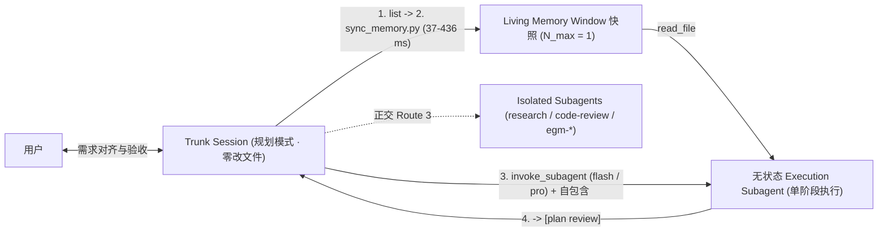

# Dual-Brain Orchestrator（双脑编排插件）

[English](README.md) | 简体中文

[](CHANGELOG.md)
[](https://github.com/titicheck/dual-brain-orchestrator/actions/workflows/test.yml)
[](skills/orchestrator/scripts/sync_memory.py)
[](plugin.json)
[](LICENSE)

面向 **Antigravity 单模型会话**的无状态“规划与执行”（Plan-and-Execute）双脑编排插件——将热缓存的主干规划会话（`Trunk Session`）与单次无状态执行子代理（`Execution Subagent`）配对，通过无损且受压缩边界约束的 `Living Memory Window` 快照同步（`N_max = 1`），以零第三方依赖实现 **34–84% 额度节省**。

---

## 工作原理

原生同线程切换规划/执行模型会在每次交接时触发 `69.7%–75.1%` 的 KV-Cache 未命中；`orchestrator v2.0.x` 让主干规划会话（`Trunk Session`）始终保活在前沿模型热缓存中，并在每次执行波次拉起一个干净的无状态 `Execution Subagent`（`flash` 或 `pro`）：



- **零写盘 `Trunk Session`：** 仅做只读调研、编写自包含五段 `<plan>` 派发指令，并通过轻量级 Tier-1 检查（`git status --short` / `git diff --stat`）验收 `<report>`。
- **无状态 `Always-New` 执行（`N_max = 1`）：** 每次派发读取干净的 `[latest CHECKPOINT .. current Trunk step]` 快照，从物理根源消灭 Antigravity 多轮派发的 `10 KB / N` 压缩截断问题（活动 `<plan>` 跨压缩完整保留 `~8.6–8.8 KB`）。

---

## 诚实实测与回测亮点

基于 `281` 条生产轨迹（`17,414` 步、`3,566.91M` tokens）、`314` 次实测原生切换及 `75` 次历史派发审计（详见证据汇总 [docs/research/06-v2-stateless-benchmark-and-pareto-evaluation.md](docs/research/06-v2-stateless-benchmark-and-pareto-evaluation.md)）：

| 评测维度 | 实测 / 回测表现 | 对比基线 | 证据标签 |
|---|---|---|---|
| **多小时长会话花费**（`L0-4`、`L0-3`） | **`$66.19`**（`L0-4`）；**`-42.9%`**（`L0-3`，按 `1x` 对齐） | `$100.81` 同深度原生 `Orchestrator`（`L0-2`） | `[Measured Production Telemetry]` |
| **KV-Cache 命中与切换失效**（`314` 次切换） | **`95.02%`** 会话命中率（`L0-4`） | `89.22%`（`L0-2`）；原生模型切换 `69.7%–75.1%` 未缓存 | `[Measured Production Telemetry]` |
| **压缩冻结与流式稳定性** | **`1 / 134`** 压缩；**`0`** 次超时（每千步快 `15–25 分钟`） | 每 `44–58` 步冻结 `68.7–89.0s`；`L0-2` 出现 `31` 次 `retryInfos` | `[Measured Production Telemetry]` |
| **持续会话短微调**（`LMW 20–100 KB, K = 1..12`） | **`45 / 45` 全格胜出**（跨 `1x`/`N-2x`/`Sub-3x` 省 **`-45%..-84%`**） | 只要 `LMW >= 2.8 KB`（第 2 轮起）即稳赢官方 | `[Measured Switches + Sim-vs-Sim Backtest]` |
| **无状态 `v2.0.x` vs `v1.1.x` / `v1.2.1`**（`75` 次派发） | **`4.27s`** 冷启动（`42h` LLM 净增 `+1.4 分钟`）；**`-$13.45`** `1x` / **`-$36.37`** `2x` | 严控回测反超 `v1.2.1` `Pure q=0`（**`-$0.57`** `1x` / **`-$3.76`** `2x`） | `[Measured Boot + Sim-vs-Sim Backtest]` |
| **跨模型放大效应**（`Codex` / `Claude`） | 无状态相对 `v1.2.1` 领先放大 **`1.46x–2.85x`**（`-$2.15..-$16.89`） | 更高缓存读占比（`alpha = 0.10–0.25`）进一步放大 `Always-New` 优势 | `[Sim-vs-Sim Backtest]` |

> [!NOTE]
> **诚实权衡与边界说明：**
> - **首轮空会话微改（`S1`）：** 全新空白会话下 `1`–`2` 行修改需支付固定 `sync` + `SPAWN_NEW` + `[plan review]` 开销（`~$0.04–$0.07`、`+25–40s`），此类单次微改更适合原生单模型或官方原生模式。
> - **宿主物理 UX 上限（`Dim 10`）：** 不支持执行中途软中断（`[plan review due]`）、主聊天窗实时内联 diff 展示或跨派发常驻后台进程；详见 [.out-of-scope/host-physical-ux-and-runtime-ceilings.md](.out-of-scope/host-physical-ux-and-runtime-ceilings.md)。
> - **实盘验收状态：** `v2.0.x` 待完成 `L0-5` 真实长会话验收，并在 [Ticket 13](.scratch/orchestrator-v1/issues/13-v113-empirical-watch-and-residual-boundaries.md) 登记了锚定 `v1.2.1`（`1511ee5`）的 `3` 条客观回滚触发条件。

---

## 实战模式选型指南

| 模式 | 适用场景 | 核心原因 |
|---|---|---|
| **`orchestrator v2.0.x`（`flash` / `pro`）** | `>= 60` 步开发、高上下文 UI 分支（`S2`）、慢编译测试（`S7`）、绿地/单体项目（`S6`、`S8a`、`S8b`）、第 2 轮起连续微调 | 省 `34–84%` 额度、`Trunk Session` 极低压缩（`1/134`）且零超时；紧耦合大单体（`S8b`）可在项目级切 `orchestrator-tier: pro` |
| **官方原生 `Orchestrator (Neon)`** | `< 50` 步已明确短迭代（`S5`）、需实时内联 diff 与中途软中断的 CLI 调试 | `< 50` 步独立任务墙钟快 `3–4 分钟`，支持宿主级写拦截与内联 diff |
| **原生单模型（`Neon` / `Opus`）** | `S1` 纯问答、首轮 `1`–`2` 行微改、`15–60s` 交互脚本、本地常驻服务（daemon） | 零编排启动/审查开销，完整保留实时 stderr 与常驻后台进程 |
| **`/swarm` + `orchestrator` 混合** | 跨模型家族红队评审、双仓元工程（`S9`） | 将 `/swarm` 多模型辩论与隔离的 `Execution Subagent` 落地实现无缝结合 |

---

## 快速开始与共享规则接入

### 安装方式（纯 Skill 包）

`orchestrator` 仅包含根目录 [plugin.json](plugin.json) 与独立自包含的 [skills/orchestrator/](skills/orchestrator/SKILL.md) 目录——V1 版本不包含任何捆绑 `rules/` 目录、启动钩子（startup hooks）、常驻后台进程（sidecar）或非 Antigravity 客户端清单。

- **作为 Antigravity 纯 Skill 插件安装：** 直接克隆至 Antigravity 插件目录（`git clone https://github.com/titicheck/dual-brain-orchestrator.git ~/.gemini/config/plugins/orchestrator`），或运行 `agy plugin install <path>`。
- **作为独立 Skill 使用：** 将 `skills/orchestrator` 软链接或复制到 Antigravity 的 skills 目录中。
- **零配置斜杠命令调用：** 在任意未配置规则的 Antigravity 对话框中直接输入 `/orchestrator`，即可按内置默认 `flash` 档位运行同一套统一工作流。

### 标准规则接入片段（`< 1,000` 字节）

将以下片段写入你的共享工程规则库 `AGENTS.md`（或全局 `~/.gemini/GEMINI.md`）即可；日常项目只需引用该共享规则库，**无需**在项目自身配置文件中单独添加任何 `orchestrator` 条目（英文版片段见 [README.md](README.md)）：

```markdown
## Orchestrator

仅在由人类发起的顶层单模型会话（含上下文压缩后）中，且未暴露精确小写 `exit_plan_mode`/`enter_plan_mode`、非 `/swarm` 流程时，于规划或执行涉及文件/状态修改与外部副作用的任务，或处理已绑定 `Execution Subagent` 回报时加载 `orchestrator`（遵循其 `SKILL.md`）。绑定执行子代理档位锁死为静态 `orchestrator-tier:` 规则（口头模型请求绝不覆盖；单项目可在工作区 `AGENTS.md` 声明同名指令覆盖）。

orchestrator-tier: flash
```

### 静态档位作用域优先级（`orchestrator-tier:`）

执行子代理档位仅接受 `flash`、`pro`、`flash_lite` 或 `inherit`，并严格按以下具体度从高到低从静态规则解析（对话中的口头模型请求不会更改该档位）：

1. 工作区本地 `AGENTS.md` / `GEMINI.md`
2. 全局直写 `~/.gemini/GEMINI.md`
3. `@[...]` 导入的共享工程规则（如 `engineering-kit/rules/AGENTS.md`）
4. 内置默认值 `"flash"`

若仅需为单个项目覆盖执行档位，只需在该项目的 `AGENTS.md` 中添加一行（若同文件含 `@[...]` 导入，请置于导入行之后）：

```markdown
orchestrator-tier: pro
```

---

## 架构（`v2.0.x`）、验证与路线图

### 包结构与跨客户端扩展边界

- [skills/orchestrator/SKILL.md](skills/orchestrator/SKILL.md) — `Trunk Session` 控制循环、有序准入闸门（Entry Gate）、三路入站路由、Official Part 2 规划与 Part 7 `[plan review]`。
- [skills/orchestrator/references/execution-protocol.md](skills/orchestrator/references/execution-protocol.md) — 与宿主解耦的单阶段 `Execution Subagent` 执行协议（Official Parts 4 与 5）。
- [skills/orchestrator/references/harnesses.md](skills/orchestrator/references/harnesses.md) — Antigravity V1 宿主绑定（`invoke_subagent`、`manage_subagents`、同级 `logAbsoluteUri`、`sync_memory.py` CLI）及面向 Claude Code / Codex 的预留未来客户端适配接缝。
- [skills/orchestrator/scripts/sync_memory.py](skills/orchestrator/scripts/sync_memory.py) — 零第三方依赖的 Python 3 标准库同步 CLI（`841` 行；`check-origin`、`sync`、`bind`、`reset`），在每次派发时导出无状态 `Always-New` 当前纪元 `Living Memory Window` 快照（`N_max = 1`，单遍耗时 `37–436 ms`）。

### 自动化测试套件（`Seam 1` + `Seam 2A`）

```powershell
py -3 -m unittest discover -s tests -v
```
*（POSIX 系统请使用 `python3 -m unittest discover -s tests -v`。）*

### `Seam 2B` — Antigravity 实机冒烟验证与原生对比清单

在 V1 上运行以下 4 项交互式 Antigravity 检查，并与原生 `Orchestrator` 并排对比：

1. **无条件退让原生 Orchestrator**：在暴露精确小写 `exit_plan_mode` / `enter_plan_mode` 的 `Orchestrator (Carbon)` / `Orchestrator (Neon)` / `Orchestrator (Argon)` 会话中触发编码任务与 `/orchestrator ...`；确认原生同线程热切换完整运行，且零 `sync_memory.py` 调用、零额外派发 `Execution Subagent`。
2. **防递归、压缩后纯问答直答与三路路由**：确认子代理（含 `Execution Subagent` 嵌套子代理）与 `[swarm]`/`[board]` worker 在实时会话及压缩后均保持单阶段（`check-origin` 对 `"SUBAGENT"` 或 `"UNKNOWN"` 故障闭锁），压缩后的纯问答回合零 `sync_memory.py` 调用与写盘，非绑定原生子代理的 `[Message]` 回复保留在 `Trunk Session`，以及被取代的孤儿 `Execution Subagent` 被忽略/终止。
3. **静态档位锁与 Approve-First / `[plan review]` 连续性**：确认共享规则接入与未配置 `/orchestrator` 锁定在 `"flash"`（忽略对话中的 `"use pro"`），在工作区 `AGENTS.md` 添加 `orchestrator-tier: pro` 会在下一次无状态 `Execution Subagent` 派发时立即生效，且 Approve-First / 中途取消 / `[plan review]` 均平稳衔接不丢失活跃状态。
4. **正交原生子代理与计划内嵌套委派**：在运行 `flash` 档 `Execution Subagent` 的前沿单模型 `Trunk Session` 中，确认 `Trunk Session` 上的只读 `Isolated Subagent`（`egm-*` / `research` / `code-review`）以及 `Execution Subagent` 内部派生的计划内原生子代理均零 `Living Memory Window` 注入、完全不受 `orchestrator-tier:` 影响，并遵循各自原生的工作区/插件/任务档位规则。

### 文档与工程档案

- [CHANGELOG.md](CHANGELOG.md) — 版本演进记录（`v1.0.0` 至 `v2.0.1`，标注 `v1.2.1` `1511ee5` 回滚锚点）。
- [GLOSSARY.md](GLOSSARY.md) — 双脑架构统一术语表（`Trunk Session`、`Execution Subagent`、`Isolated Subagent`、`Living Memory Window`）。
- [docs/adr/](docs/adr/0001-unified-subagent-report-return-into-plan-review.md) — 架构决策记录（`ADR-0001` 至 `ADR-0007`）。
- [docs/research/](docs/research/06-v2-stateless-benchmark-and-pareto-evaluation.md) — 官方基线解构（`01`）、宿主原语（`02`–`04`）、KV-Cache TTL 审计（`05`）与 `v2.0.x` Pareto 评估（`06`）。

### 路线图与明确非目标（Non-Goals）

- **下一步：** 对照 [Ticket 13](.scratch/orchestrator-v1/issues/13-v113-empirical-watch-and-residual-boundaries.md) 证伪指标（`M1`–`M6`）完成 `L0-5` 多小时生产实盘验收，并在 [harnesses.md](skills/orchestrator/references/harnesses.md) §5 落地 Claude Code `Agent` / Codex `spawn_agent` 适配接缝。
- **明确非目标：** 不引入 `PreToolUse` 生命周期 `hooks.json`、不采用脚本化 `run_workflow` 载体、不做 Agent 级 KV-Cache 保活心跳、不开设 `Trunk Session` 微改豁免（[ADR-0006](docs/adr/0006-pareto-boundary-reject-lifecycle-hooks-and-workflow-carrier.md)）。
