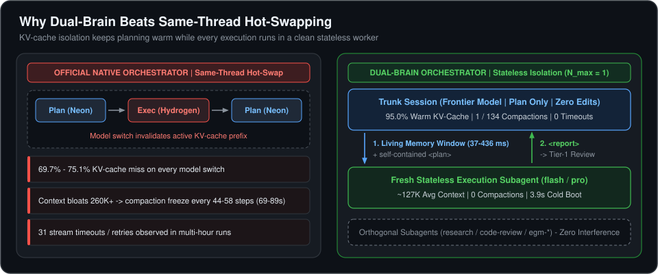
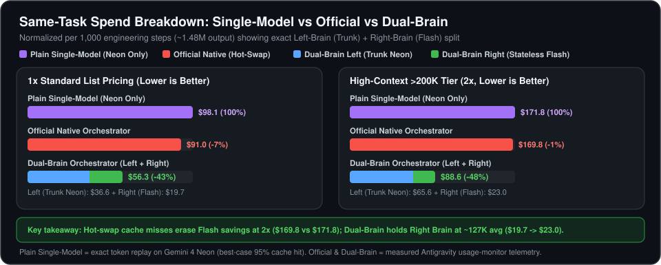
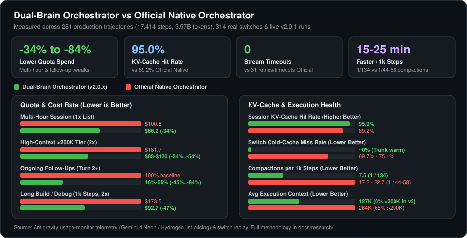

# Dual-Brain Orchestrator（双脑编排插件）

[English](README.md) | 简体中文

[](CHANGELOG.md)
[](https://github.com/titicheck/dual-brain-orchestrator/actions/workflows/test.yml)
[](skills/orchestrator/scripts/sync_memory.py)
[](plugin.json)
[](LICENSE)

面向 **Antigravity 单模型会话**的无状态双脑编排插件——让前沿模型 `Trunk Session` 常驻 KV-Cache 热缓存进行规划与验收，每次执行波次拉起干净的无状态 `Execution Subagent`，相比官方原生模式节省 **34%–84% 额度**且零第三方依赖。

---

## 工作原理



- **零写盘、热缓存 `Trunk Session`：** 仅做只读调研、编写自包含五段 `<plan>`，并用轻量级 Tier-1 足迹校验（`git status --short` / `git diff --stat`）验收每份 `<report>`，杜绝单线程内模型热切换。
- **无状态 `Execution Subagent`（`N_max = 1`）：** 每次派发全新冷启动（`~3.9s`），读取无损活动纪元 `Living Memory Window` 快照（`37–436 ms`）单阶段执行，从根源消除多轮压缩截断与跨模型缓存震荡。

---

## 成本拆解与官方原生对比



*纯单模型在每个执行步都支付前沿模型单价；官方原生在 `>200K` `2x` 档因模型切换缓存失效几乎抹平了 Flash 的廉价优势（`$169.8` vs `$171.8`）；Dual-Brain 将左脑（`Trunk Session`：`$36.6` 1x / `$65.6` 2x）与右脑（无状态 `Flash`：`$19.7` 1x / `$23.0` 2x）彻底拆分隔离，实测总花费直降 **43%–48%**。*



| 对比维度 | Dual-Brain Orchestrator | 官方原生 Orchestrator |
|---|---|---|
| **额度与高上下文费率** | 同任务较纯前沿单模型省 **43%–48%**；多小时长会话省 **34%**（`$66.2` vs `$100.8` 1x）；第 2 轮起连续微调省 **45%–84%**；`>200K` `2x` 档省 **47%–54%** | `1x` 仅省 **7%**（`$91.0`），`>200K` `2x` 仅省 **1%**（`$169.8`），切换冷启动失效抵消了 Flash 单价优势 |
| **KV-Cache 与上下文控制** | `Trunk Session` 命中率 **95.0%**；无状态执行平均上下文 **~127K**（`v2.0.1` 实盘 **0%** 触发 `>200K`） | 会话命中率 **89.2%**；每次模型切换 **69.7%–75.1%** token 未命中；平均上下文 **264K**（**65%** `>200K`） |
| **速度与流式稳定性** | **1 / 134** 步压缩、**0 次**流式超时（每千步快 **15–25 分钟**）；子代理启动仅 `3.9s` | 每 **44–58** 步压缩一次（冻结 **69–89s**），长会话出现 **31 次**流式重试/超时 |
| **规划与执行相互校验** | 全新无状态 `Execution Subagent` 无规划期确认偏误，修改前先校验 `<plan>` 与现网文件/测试；`Trunk Session` 将每份 `<report>` 视为不可信输入复核 | 同线程执行直接继承规划偏误，缺乏独立视角校验 |
| **静态档位锁与跨端接缝** | 支持静态 `orchestrator-tier:` 档位锁（`flash` / `pro` / `flash_lite` / `inherit`）及单项目覆盖；无状态适配接缝已预留给未来跨客户端扩展 | 固定绑定宿主模型组合，不支持按仓库声明静态档位 |

---

## 局限性与当前边界

- **谷歌后端 `~300s`（5 分钟）隐式 KV-Cache TTL 断崖：** 服务端隐式 KV-Cache 仅在 `~60s` 内接近必中（`~99%`），超过 **`~300s`（5 分钟）**即退化为机会式 LRU（`5–10 分钟`约 `50%`，`10–30 分钟`约 `35%–41%`），超过 `30 分钟`基本失效（`< 4%`）。当长执行波次（`> 5 分钟`）或跨休息停顿后 `Trunk Session` 唤醒时会触发一次冷重载（建议：长停顿前或大阶段切换时手动执行 `/compact`，可将冷重载开销直降 `~90%`；本插件刻意拒绝自制心跳保活，实测净负收益）。
- **目前仅支持 Antigravity（Codex / Claude Code 暂未适配）：** 当前版本专门绑定 Antigravity 原生工具链（`invoke_subagent`、`manage_subagents`、`transcript.jsonl`）。**Codex**（`spawn_agent`）、**Claude Code**（`Agent`）等其他客户端适配器**尚未实现**（宿主边界已隔离在 [skills/orchestrator/references/harnesses.md](skills/orchestrator/references/harnesses.md) 第 5 节，供后续扩展）。
- **宿主物理交互天花板：** 执行期间主聊天画布无法实时内联展示子代理代码 diff；不支持执行中途不取消/不等待的软性 `[plan review due]` 中断；本地常驻 daemon / dev server 不能跨单次派发存活。
- **全新空白会话首轮 1–2 行微改固定开销：** 在全新空会话中修改极小的 `1–2` 行，会承担一次固定的 `sync` + `SPAWN_NEW` + `[plan review]` 调度成本（约 `$0.04–$0.07`、`+25–40s`）；从第 2 轮起（会话上下文 `>= 2.8 KB`）立即开始净省额度。

---

## 全局启用兼容性

全局配置一次即可——仅在安全边界内自动介入，其余场景完全透明、零干扰：

| 会话 / 功能模式 | 全局启用时的行为 | 干扰与额外开销 |
|---|---|---|
| **官方原生 `Orchestrator`**（暴露精确小写 `exit_plan_mode` / `enter_plan_mode` 的 `Orchestrator (Neon)` / `Carbon` / `Argon`） | 无条件自动退让 | **零干扰**（不调用 `sync_memory.py`，不派生执行子代理） |
| **`/swarm` 多代理协作** | 检测到非单模型工作流后静默退让 | **零干扰**（与 `/swarm` 和平共存） |
| **纯问答 / 只读代码审查** | 直接在 `Trunk Session` 内直答 | **零开销**（零 CLI 调用、零写盘、零子代理） |
| **其他原生子代理**（`research`、`code-review`、`egm-*` 等 `Isolated Subagent` 及计划内并行切片） | 严格正交隔离执行 | **零注入** `Living Memory Window`，完全不受 `orchestrator-tier:` 影响 |

---

## 快速开始

### 1. 安装（纯 Skill 包）

```bash
git clone https://github.com/titicheck/dual-brain-orchestrator.git ~/.gemini/config/plugins/orchestrator
```

*（也可使用 `agy plugin install <path>`、将 `skills/orchestrator` 复制到 skills 目录，或在任意未配置会话中直接输入 `/orchestrator` 以内置默认 `flash` 档位运行。）*

### 2. 全局启用（`< 1,000` 字节）

将以下片段写入共享规则文件 `AGENTS.md` 或全局 `~/.gemini/GEMINI.md`（日常项目无需任何单独配置）：

```markdown
## Orchestrator

仅在由人类发起的顶层单模型会话（含上下文压缩后）中，且未暴露精确小写 `exit_plan_mode`/`enter_plan_mode`、非 `/swarm` 流程时，于规划或执行涉及文件/状态修改与外部副作用的任务，或处理已绑定 `Execution Subagent` 回报时加载 `orchestrator`（遵循其 `SKILL.md`）。绑定执行子代理档位锁死为静态 `orchestrator-tier:` 规则（口头模型请求绝不覆盖；单项目可在工作区 `AGENTS.md` 声明同名指令覆盖）。

orchestrator-tier: flash
```

### 3. 单项目档位覆盖（可选）

优先级（从高到低）：工作区 `AGENTS.md` / `GEMINI.md` > 全局 `~/.gemini/GEMINI.md` > `@[...]` 导入的共享规则 > 内置默认 `flash`（对话中的口头请求绝不覆盖）。若需将大型耦合仓库固定为 `pro`，只需在该项目 `AGENTS.md`（置于 `@[...]` 导入行之后）添加一行：

```markdown
orchestrator-tier: pro
```

---

<details>
<summary>架构细节、自动化测试与实机验证清单（Seam 2B）</summary>

### 包结构

- [skills/orchestrator/SKILL.md](skills/orchestrator/SKILL.md) — `Trunk Session` 控制循环、准入闸门、三路入站路由、规划与 `[plan review]`。
- [skills/orchestrator/references/execution-protocol.md](skills/orchestrator/references/execution-protocol.md) — 与宿主解耦的单阶段 `Execution Subagent` 执行协议。
- [skills/orchestrator/references/harnesses.md](skills/orchestrator/references/harnesses.md) — Antigravity V1 宿主绑定（`invoke_subagent`、`manage_subagents`、`sync_memory.py` CLI）及 Claude Code / Codex 跨端适配接缝。
- [skills/orchestrator/scripts/sync_memory.py](skills/orchestrator/scripts/sync_memory.py) — 零依赖 Python 3 标准库 CLI（`841` 行；`check-origin`、`sync`、`bind`、`reset`；`37–436 ms`）。

### 自动化测试

```powershell
py -3 -m unittest discover -s tests -v
```

*（POSIX 系统：`python3 -m unittest discover -s tests -v`。）*

### `Seam 2B` — Antigravity 实机冒烟验证清单

1. **无条件退让原生 Orchestrator**：在暴露精确小写 `exit_plan_mode` / `enter_plan_mode` 的 `Orchestrator (Neon)` / `Carbon` / `Argon` 会话中，确认原生同线程热切换完整运行且零 `sync_memory.py` 调用或派生 `Execution Subagent`。
2. **防递归、压缩后纯问答与三路路由**：确认 `check-origin` 将子代理（`"SUBAGENT"` / `"UNKNOWN"`）保持为单阶段、压缩后纯问答零 CLI/写盘、非绑定子代理回复留在 `Trunk Session`。
3. **静态档位锁与连续性**：确认共享规则与 `/orchestrator` 锁定 `"flash"`、工作区 `orchestrator-tier: pro` 在下一次无状态派发立即生效，且 Approve-First / 中途取消 / `[plan review]` 跨压缩连贯。
4. **正交原生子代理**：确认 `Isolated Subagent`（`research`、`code-review`、`egm-*`）与计划内子代理零 `Living Memory Window` 注入，且不受 `orchestrator-tier:` 影响。

### 文档与开源协议

- [CHANGELOG.md](CHANGELOG.md) | [GLOSSARY.md](GLOSSARY.md) | [docs/adr/](docs/adr/0001-unified-subagent-report-return-into-plan-review.md) | [docs/research/](docs/research/06-v2-stateless-benchmark-and-pareto-evaluation.md) | [LICENSE](LICENSE)

</details>
